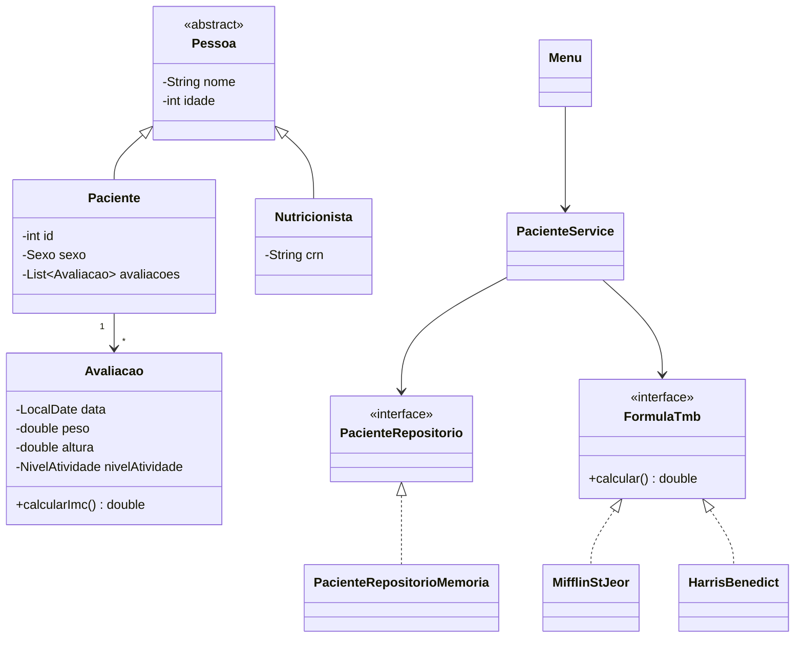
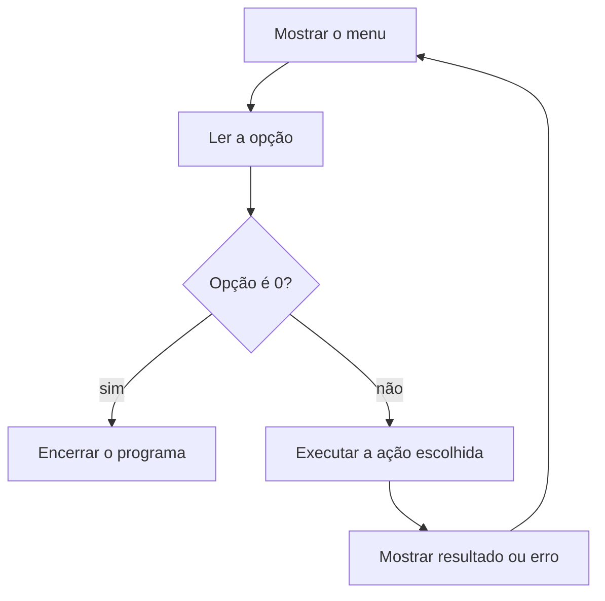

# Sistema de Nutrição

Sistema de apoio à rotina de nutrição, desenvolvido em **Java** e criado em etapas: começa como uma aplicação de terminal em Java puro, para consolidar os fundamentos da linguagem, e evolui para uma aplicação web com **Spring Boot**, **PostgreSQL** e, possivelmente, **React**.

> **Status:** em desenvolvimento (versão 1, Java puro no terminal).

## Sobre o projeto

O objetivo é construir, passo a passo, um sistema para cadastrar pacientes, registrar avaliações (peso, altura e nível de atividade física) e calcular indicadores nutricionais, como IMC, taxa metabólica basal e gasto energético total.

O projeto tem dois propósitos:

1. **Aprender na prática:** aplicar os conceitos de Java vistos no curso, num problema real e não em exercícios soltos.
2. **Entregar algo útil:** chegar a uma ferramenta que possa ser usada no trabalho de quem atua com nutrição.

A versão 1 foi desenhada para que a maior parte do código possa ser **reaproveitada na migração para o Spring Boot**. Por isso, a regra do sistema é totalmente separada da entrada e saída de dados.

## Funcionalidades

**Versão 1 (terminal)**

- [ ] Cadastrar paciente
- [ ] Listar pacientes
- [ ] Buscar paciente por nome
- [ ] Registrar avaliação (peso, altura e nível de atividade)
- [ ] Ver resultados da última avaliação (IMC, classificação, TMB e gasto energético total)
- [ ] Ver histórico de avaliações de um paciente

**Fora do escopo da versão 1:** plano alimentar e cardápios, banco de dados, login, relatórios em PDF, atendimento de crianças e idosos.

## Tecnologias

| Etapa | Tecnologias |
|---|---|
| Versão 1 | Java 17+ (sem frameworks), dados em memória |
| Versão 2 | Spring Boot, Spring Data JPA, PostgreSQL |
| Versão 3 | React (a confirmar) |

## Conceitos de Java praticados

- **Operadores:** cálculos de IMC, TMB e gasto energético; validações com `&&` e `||`.
- **Controle de fluxo:** menu com `do while` e `switch`, validações com `if/else`, listagens com `for`.
- **Encapsulamento:** atributos privados com getters e validação nos setters.
- **Herança:** `Paciente` e `Nutricionista` herdam de `Pessoa`.
- **Abstração:** classe abstrata `Pessoa` e interface `FormulaTmb`.
- **Polimorfismo:** diferentes fórmulas de TMB implementam a mesma interface.
- **Exceções:** exceções próprias para dados inválidos e paciente não encontrado.

## Arquitetura

O projeto é dividido em pacotes, e **somente o pacote `console` usa `Scanner` e `System.out`**.

```
src/
└── nutricao/
    ├── dominio/       Pessoa, Paciente, Nutricionista, Avaliacao,
    │                  Sexo, NivelAtividade, ClassificacaoImc
    ├── calculo/       FormulaTmb, MifflinStJeor, HarrisBenedict
    ├── excecao/       DadoInvalidoException, PacienteNaoEncontradoException
    ├── repositorio/   PacienteRepositorio, PacienteRepositorioMemoria
    ├── servico/       PacienteService
    └── console/       Menu, Main
```

### Diagrama de classes



### Fluxo do menu



## Regras de negócio

> As fórmulas e faixas abaixo são referências comuns na nutrição e devem ser validadas por um profissional da área antes de qualquer uso real.

**Cadastro e avaliação**

- O nome é obrigatório.
- Nesta versão, só são aceitos adultos de 18 a 59 anos.
- O sexo é obrigatório, pois as fórmulas de TMB dependem dele.
- Peso em kg: maior que 0 e no máximo 500.
- Altura em metros: entre 0,50 e 2,50.
- O nível de atividade é obrigatório.
- Cada avaliação guarda sua data. Avaliações não são editadas nem apagadas, apenas adicionadas, formando o histórico.

**Cálculos**

- **IMC** = peso ÷ (altura × altura)
- **Classificação do IMC (adultos):** abaixo de 18,5 baixo peso · 18,5 a 24,9 eutrofia · 25,0 a 29,9 sobrepeso · 30,0 a 34,9 obesidade grau I · 35,0 a 39,9 obesidade grau II · 40,0 ou mais obesidade grau III
- **TMB:** fórmulas de Mifflin-St Jeor e de Harris-Benedict (revisada)
- **Gasto energético total** = TMB × fator de atividade (sedentário 1,2 · leve 1,375 · moderado 1,55 · intenso 1,725 · muito intenso 1,9)

## Como executar

Pré-requisitos: **JDK 17 ou superior**.

```bash
git clone https://github.com/Eu-Lucas-Hickmann/NOME-DO-REPOSITORIO.git
```

Abra o projeto no IntelliJ IDEA (ou outra IDE) e execute a classe `Main`, do pacote `nutricao.console`.

## Roadmap

- [ ] **v1:** aplicação de terminal em Java puro, com dados em memória
- [ ] **v2:** migração para Spring Boot com API REST e PostgreSQL
- [ ] **v3:** interface web (React, a confirmar)
- [ ] Plano alimentar
- [ ] Autenticação e controle de acesso

## Aviso sobre dados

Dados de saúde são considerados **dados sensíveis** pela LGPD. Este repositório deve conter apenas **dados fictícios de teste**. Antes de qualquer uso com pacientes reais, será necessário implementar autenticação, controle de acesso, backup, hospedagem segura e consentimento dos pacientes.

## Autor

**Lucas Hickmann**, estudante de Ciência da Computação na FURB.

## Licença

Defina a licença do projeto (por exemplo, MIT) e adicione o arquivo `LICENSE` na raiz do repositório.