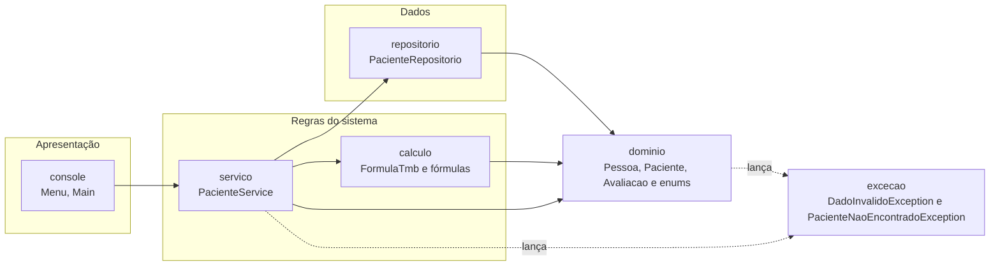
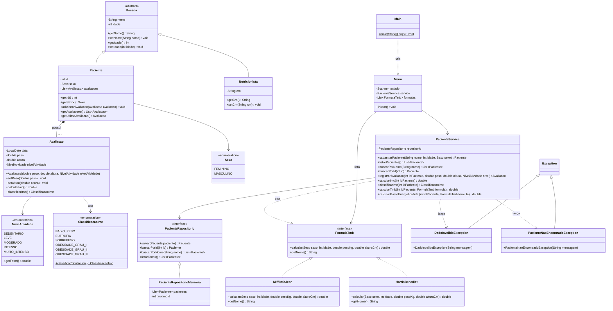
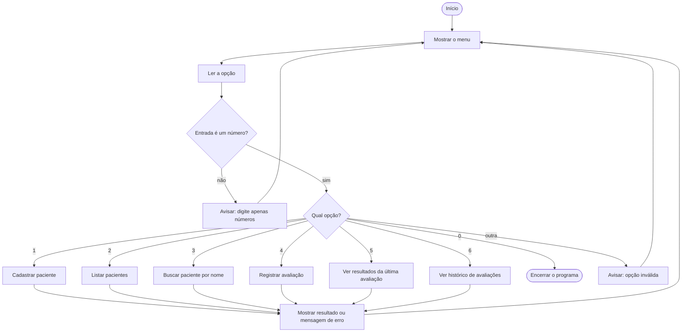
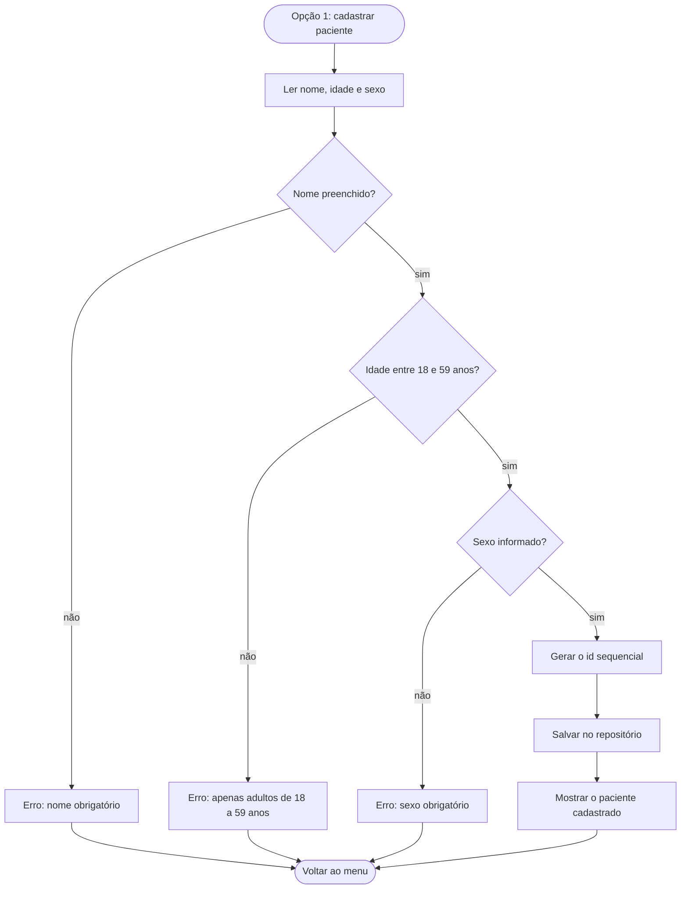
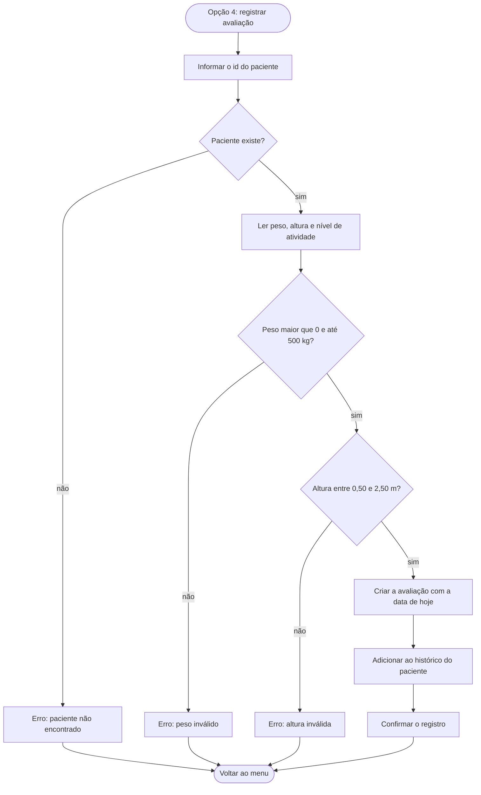
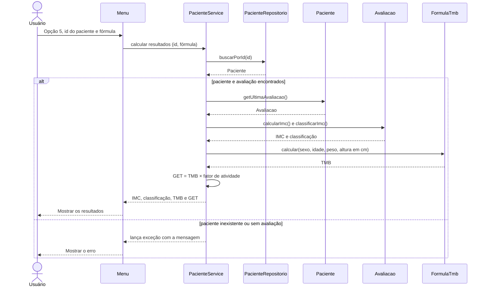
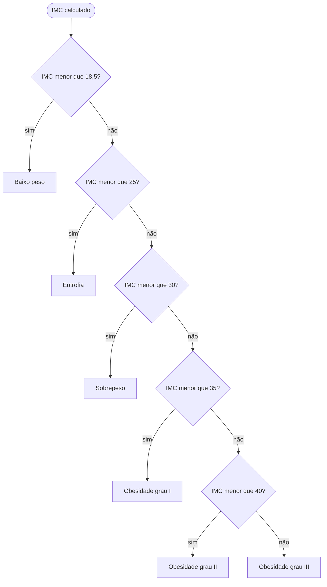
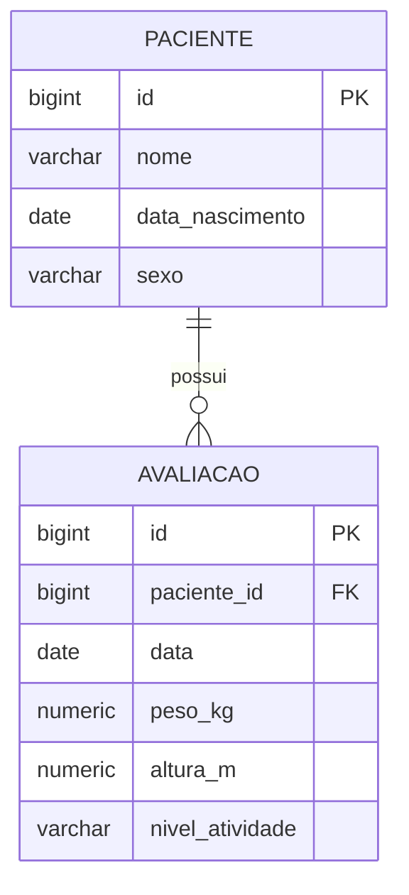

# Sistema de Nutrição


Sistema de apoio à rotina de nutrição, desenvolvido em **Java** e criado em etapas: começa como uma aplicação de terminal em Java puro, para consolidar os fundamentos da linguagem, e evolui para uma aplicação web com **Spring Boot**, **PostgreSQL** e, possivelmente, **React**.

> **Status:** em desenvolvimento. A versão 1 (Java puro, no terminal) está sendo construída. Veja a seção [Progresso](#progresso).

## Sumário

- [Sobre o projeto](#sobre-o-projeto)
- [Progresso](#progresso)
- [Funcionalidades](#funcionalidades)
- [Tecnologias](#tecnologias)
- [Conceitos de Java praticados](#conceitos-de-java-praticados)
- [Arquitetura](#arquitetura)
- [Diagramas](#diagramas)
- [Regras de negócio](#regras-de-negócio)
- [Como executar](#como-executar)
- [Roadmap](#roadmap)
- [Aviso sobre dados](#aviso-sobre-dados)
- [Autor](#autor)
- [Licença](#licença)

## Sobre o projeto

O objetivo é construir, passo a passo, um sistema para cadastrar pacientes, registrar avaliações (peso, altura e nível de atividade física) e calcular indicadores nutricionais, como IMC, taxa metabólica basal (TMB) e gasto energético total (GET).

O projeto tem dois propósitos:

1. **Aprender na prática:** aplicar os conceitos de Java vistos no curso num problema real, e não em exercícios soltos.
2. **Entregar algo útil:** chegar a uma ferramenta que possa ser usada no trabalho de quem atua com nutrição.

A versão 1 foi desenhada para que a maior parte do código possa ser **reaproveitada na migração para o Spring Boot**. Por isso, as regras do sistema são totalmente separadas da entrada e saída de dados: **somente o pacote `console` usa `Scanner` e `System.out`**.

## Progresso

Estado da versão 1:

- [x] Estrutura de pacotes (`dominio`, `calculo`, `excecao`, `repositorio`, `servico`, `console`)
- [x] Enums de sexo, nível de atividade e classificação de IMC
- [x] Exceções próprias
- [ ] `Pessoa`, `Paciente` e `Nutricionista` completos (validações, sexo e id sequencial)
- [ ] `Avaliacao` completa (data, validações de peso e altura, classificação do IMC)
- [ ] Fórmulas de TMB (`MifflinStJeor` e `HarrisBenedict`) e fatores de atividade
- [ ] `PacienteRepositorio` e `PacienteRepositorioMemoria`
- [ ] `PacienteService`
- [ ] `Menu` com todas as opções
- [ ] Testes unitários

## Funcionalidades

**Versão 1 (terminal)**

- [ ] Cadastrar paciente
- [ ] Listar pacientes
- [ ] Buscar paciente por nome
- [ ] Registrar avaliação (peso, altura e nível de atividade)
- [ ] Ver resultados da última avaliação (IMC, classificação, TMB e GET)
- [ ] Ver histórico de avaliações de um paciente

**Fora do escopo da versão 1:** plano alimentar e cardápios, banco de dados, login, relatórios em PDF, atendimento de crianças e idosos.

## Tecnologias

| Etapa | Tecnologias |
|---|---|
| Versão 1 | Java (sem frameworks), Maven, dados em memória |
| Versão 2 | Spring Boot, Spring Data JPA, PostgreSQL |
| Versão 3 | React (a confirmar) |

## Conceitos de Java praticados

- **Operadores:** cálculos de IMC, TMB e GET; validações com `&&` e `||`.
- **Controle de fluxo:** menu com `do while` e `switch`, validações com `if/else`, listagens com `for`, `break` e `continue` em buscas.
- **Encapsulamento:** atributos privados com getters e validação nos setters.
- **Herança:** `Paciente` e `Nutricionista` herdam de `Pessoa`.
- **Abstração:** classe abstrata `Pessoa` e interfaces `FormulaTmb` e `PacienteRepositorio`.
- **Polimorfismo:** diferentes fórmulas de TMB implementam a mesma interface.
- **Exceções:** exceções próprias para dados inválidos e paciente não encontrado, tratadas com `try/catch` no menu.

## Arquitetura

O projeto segue o layout padrão do Maven e é dividido em pacotes por responsabilidade:

```
SistemaNutri/
├── pom.xml
├── README.md
└── src/
    └── main/
        └── java/
            └── nutricao/
                ├── dominio/       Pessoa, Paciente, Nutricionista, Avaliacao,
                │                  Sexo, NivelAtividade, ClassificacaoImc
                ├── calculo/       FormulaTmb, MifflinStJeor, HarrisBenedict
                ├── excecao/       DadoInvalidoException, PacienteNaoEncontradoException
                ├── repositorio/   PacienteRepositorio, PacienteRepositorioMemoria
                ├── servico/       PacienteService
                └── console/       Menu, Main   (único lugar com Scanner e System.out)
```

### Camadas e dependências



Na migração para o Spring Boot, `dominio` vira as entidades, `repositorio` vira Spring Data JPA, `servico` vira classes `@Service`, `console` é substituído por controllers REST e `calculo` continua igual.

## Diagramas

### Diagrama de classes



### Fluxo do menu principal



### Fluxo: cadastrar paciente



### Fluxo: registrar avaliação



### Sequência: ver resultados da última avaliação



### Classificação do IMC

Os limites são contínuos: cada faixa vale até o limite seguinte, sem lacunas entre valores decimais.



### Modelo de dados previsto para a versão 2

Rascunho das tabelas no PostgreSQL. A idade passa a ser calculada a partir da data de nascimento, e o id passa a ser gerado pelo banco.



## Regras de negócio

> As fórmulas e faixas abaixo são referências comuns na nutrição e devem ser validadas por um profissional da área antes de qualquer uso real.

### Cadastro do paciente

- **RN01:** o nome é obrigatório e não pode ser vazio.
- **RN02:** nesta versão, só são aceitos adultos de 18 a 59 anos (limites incluídos). A classificação do IMC para crianças e idosos usa critérios diferentes.
- **RN03:** o sexo é obrigatório (feminino ou masculino), pois as fórmulas de TMB dependem dele.
- **RN04:** cada paciente recebe um id sequencial automático. Nomes repetidos são permitidos.

### Avaliação

- **RN05:** peso em kg, maior que 0 e no máximo 500 (o 500 é aceito).
- **RN06:** altura em metros, entre 0,50 e 2,50 (os dois limites são aceitos).
- **RN07:** o nível de atividade é obrigatório: sedentário, leve, moderado, intenso ou muito intenso.
- **RN08:** toda avaliação guarda a data em que foi registrada. Avaliações não são editadas nem apagadas, apenas adicionadas, formando o histórico.
- **RN09:** paciente sem avaliação não tem resultados; o sistema mostra uma mensagem clara.

### Regras gerais

- **RN10:** dado inválido nunca gera um resultado estranho: o sistema recusa o dado e explica o motivo, por meio de exceções.
- **RN11:** paciente não encontrado gera uma mensagem de "não encontrado", sem derrubar o programa.

### Cálculos

**IMC** = peso ÷ (altura × altura)

**Classificação do IMC (adultos):**

| IMC | Classificação |
|---|---|
| menor que 18,5 | Baixo peso |
| de 18,5 até menos de 25 | Eutrofia |
| de 25 até menos de 30 | Sobrepeso |
| de 30 até menos de 35 | Obesidade grau I |
| de 35 até menos de 40 | Obesidade grau II |
| 40 ou mais | Obesidade grau III |

**TMB, Mifflin-St Jeor** (peso em kg, altura em cm):

- homem: (10 × peso) + (6,25 × altura) − (5 × idade) + 5
- mulher: (10 × peso) + (6,25 × altura) − (5 × idade) − 161

**TMB, Harris-Benedict revisada** (peso em kg, altura em cm):

- homem: 88,362 + (13,397 × peso) + (4,799 × altura) − (5,677 × idade)
- mulher: 447,593 + (9,247 × peso) + (3,098 × altura) − (4,330 × idade)

**Gasto energético total (GET)** = TMB × fator de atividade:

| Nível de atividade | Fator |
|---|---|
| Sedentário | 1,2 |
| Leve | 1,375 |
| Moderado | 1,55 |
| Intenso | 1,725 |
| Muito intenso | 1,9 |

**Exibição:** IMC com 2 casas decimais; calorias como número inteiro.

## Como executar

Pré-requisitos: **JDK** (a versão está definida no `pom.xml`) e **Maven**, ou uma IDE como o IntelliJ IDEA, que já traz o Maven.

```bash
git clone https://github.com/Eu-Lucas-Hickmann/SistemaNutri.git
cd SistemaNutri
```

**Pela IDE:** abra o projeto e execute a classe `Main`, do pacote `nutricao.console`.

**Pelo terminal:**

```bash
mvn compile
java -cp target/classes nutricao.console.Main
```

## Roadmap

- [ ] **v1:** aplicação de terminal em Java puro, com dados em memória
- [ ] Testes unitários (JUnit) para IMC, classificação e fórmulas de TMB
- [ ] **v2:** migração para Spring Boot com API REST e PostgreSQL
- [ ] **v3:** interface web (React, a confirmar)
- [ ] Atendimento de crianças e idosos
- [ ] Plano alimentar
- [ ] Autenticação e controle de acesso

## Aviso sobre dados

Dados de saúde são considerados **dados sensíveis** pela LGPD. Este repositório deve conter apenas **dados fictícios de teste**. Antes de qualquer uso com pacientes reais, será necessário implementar autenticação, controle de acesso, backup, hospedagem segura e consentimento dos pacientes.

## Autor

**Lucas Hickmann**, estudante de Ciência da Computação na FURB.

## Licença

Este projeto ainda não possui licença definida. Enquanto nenhuma licença for adicionada, todos os direitos permanecem com o autor.